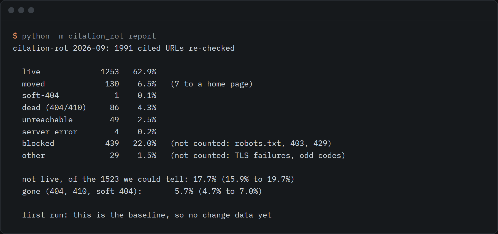

# citation-rot

A monthly re-check of URLs cited in published AI citation studies, recording dead, moved and changed pages.



```sh
git clone https://github.com/rishsadh/citation-rot && cd citation-rot
python -m citation_rot report
```

Python 3.10 or newer. No dependencies. That prints the latest month from the files in `data/`. Re-checking the panel yourself is `python -m citation_rot check`, which took about 12 minutes on the first run.

## Why this exists

On 24 July 2026 OtterlyAI published a study of 20,092,769 URLs cited by seven AI search engines and found that 19.3% were not live ([source](https://otterly.ai/blog/dead-citations-study/)). It is one snapshot, and the URL list is not published there. When I searched GitHub, npm and the web on 30 September 2026, I did not find a tool that re-checks a fixed set of cited URLs every month and publishes every record.

This is a small version of that. It draws 2,000 URLs from a published dataset of AI search answers, removes nine that a privacy audit flagged (sign-in redirects, a bot-check token and pages about individuals), freezes the remaining 1,991 as the panel, and re-checks the same URLs every month. Each month's result is one JSONL file in git, so the decay, the recoveries and the pages that changed under the same URL can be read from the history.

## What the first run found

Checked on 30 September 2026. The URLs were cited in answers from 18 March to 13 April 2025, about 17 months earlier. They come from the [Search Arena](https://huggingface.co/datasets/lmarena-ai/search-arena-v1-7k) dataset (LMArena), which records what search-enabled models from OpenAI, Perplexity and Google returned for real user prompts.

| | URLs | share |
|---|---|---|
| live | 1,253 | 62.9% |
| moved to a different page | 130 | 6.5% |
| dead (404, 410 or a soft 404) | 87 | 4.4% |
| unreachable or server error | 53 | 2.7% |
| blocked (robots.txt, 403, 429) | 439 | 22.0% |
| other (TLS failures, odd codes) | 29 | 1.5% |

Of the 1,523 pages we could judge, 17.7% were not live (95% interval 15.9% to 19.7%) and 5.7% were gone (4.7% to 7.0%).

| engine family | URLs in the panel | not live, of those judged |
|---|---|---|
| google | 849 | 15.9% (13.3% to 18.8%) |
| openai | 691 | 20.7% (17.3% to 24.5%) |
| perplexity | 968 | 16.1% (13.7% to 18.9%) |

A URL cited by more than one engine family counts in each row, so the rows add up to more than 1,991.

How to read these numbers:

- They are not a replication of the OtterlyAI figure. The engines, the dates, the sample and the treatment of redirects and blocked pages all differ. [METHOD.md](METHOD.md) lays the two side by side.
- About one URL in five was blocked, so its state is unknown. Reuters and Reddit were blocked by `robots.txt` in every case in the panel, and this tool does not fetch what `robots.txt` disallows. A high blocked share means the rot rate for those sites is unknown, not low.
- The panel has equal quotas per engine family, so the combined figures do not reflect how many URLs each engine cites. Quote the per-engine rows.
- The seeds are one dataset from one arena in spring 2025. Search Arena does not measure any engine's citation behaviour today.
- A single check is noisy. Repeat passes on 30 September 2026 disagreed on about 1% of URLs.

The full report, with breakdowns by host and by month first cited, is in [reports/2026-09.md](reports/2026-09.md).

## Use it

```sh
python -m citation_rot report                 # print the latest month, write reports/ and data/history.csv
python -m citation_rot url https://example.org/page   # check one URL once, without touching the panel
python -m citation_rot check                  # re-check the whole panel, write data/runs/YYYY-MM.jsonl
python -m citation_rot diff 2026-09 2026-10   # which URLs died, moved or came back between two runs
python -m citation_rot add URL... --source "Study name" --cited-on 2026-03-01 --engine openai
python -m citation_rot harvest                # rebuild the seed list from the Search Arena dataset (about 7 minutes)
python -m citation_rot panel --extend --cohort 2026-11   # add a new, labelled cohort of URLs to the frozen panel
```

Each URL ends up as one of `live`, `moved`, `soft-404`, `dead`, `unreachable`, `server-error`, `blocked` or `other`. `data/runs/YYYY-MM.jsonl` has one record per URL with the status, the redirect chain, the final URL, the title and a simhash of the visible text. From the second run on, a page that is live in both months counts as changed when its text differs by 10 or more of 64 simhash bits. The page itself is never stored.

To add your own URLs, give `add` a list or `--from-file urls.txt`. They land in `seeds/manual.jsonl` with where and when they were cited. The panel is frozen on purpose, so new URLs only join it as a new cohort with `panel --extend`. `add` skips local addresses, credentials in URLs and personal profile pages.

`harvest` needs the network and rebuilds `seeds/search-arena-v1-7k.jsonl`, about 30 MB, which is not committed. `panel` draws from it with a fixed seed and applies the privacy filter again at draw time. The committed 2026-09 panel was drawn before the filter gained its latest rules and then had nine URLs removed, so a fresh draw will not reproduce it exactly; `data/panel.jsonl` is the record.

How it behaves on other people's servers: it names itself in the user agent, reads `robots.txt` for every host and every redirect hop, waits at least 2 seconds between requests to one host, reads at most 256 KB per page, and never fetches what `robots.txt` disallows. It makes no attempt to get past a 403 or a paywall.

### Monthly schedule

`.github/workflows/monthly.yml` re-checks the panel on the 2nd of each month and commits the result. It is switched off: the job only runs when the repository variable `CITATION_ROT_ENABLED` is set to `true`. The 2nd comes after the first run, so the first scheduled run lands on 2 November.

## What it does not do

- It does not measure what an AI engine cites today. It re-checks pages that were cited once, in a public dataset.
- It does not judge pages it cannot fetch. Blocked and TLS-failed pages are counted and reported, then left out of the rates.
- It does not catch every dead page. YouTube gets a second check through its oEmbed endpoint, because YouTube serves a normal page for a removed video. Other sites that answer 200 for gone pages count as live. Soft-404 detection is a short list of English phrases.
- It does not show what a page said when it was cited. It only knows that the text changed since the last check.
- It runs from one machine on one network. Geo-blocked pages show as unreachable or blocked.
- The 1,991-URL panel is small next to studies that check millions of URLs. The intervals assume a random sample of the seeds and do not cover where the seeds came from.

[METHOD.md](METHOD.md) has the full method, the status rules and the known limits.

## Data source and terms

The seed URLs come from the [Search Arena dataset](https://huggingface.co/datasets/lmarena-ai/search-arena-v1-7k) (`lmarena-ai/search-arena-v1-7k`, revision `06865038ceb415c1942e58bff8f14150cbc9fbcd`), 7,000 votes collected by LMArena from 18 March to 13 April 2025. Its card says user prompts are CC-BY-4.0 and model outputs are governed by the terms of the respective model providers. This repo stores no prompt and no answer text. It keeps only each cited URL, the date of the answer and the engine family (OpenAI, Perplexity or Google), and the engine family is shown next to every URL. The URLs come from model output, so the provider terms apply to them and CC-BY-4.0 does not. Read the licence section of [METHOD.md](METHOD.md) before reusing the data, in particular the note on Google's terms for grounded results.

Citation given on the dataset card:

```bibtex
@misc{searcharena2025,
  title = {Introducing the Search Arena: Evaluating Search-Enabled AI},
  url = {https://blog.lmarena.ai/blog/2025/search-arena/},
  author = {Mihran Miroyan and Tsung-Han Wu and Logan Kenneth King and Tianle Li and Anastasios N. Angelopoulos and Wei-Lin Chiang and Narges Norouzi and Joseph E. Gonzalez},
  month = {April},
  year = {2025}
}
```

## Licence

MIT, for this repo's code and the data files it publishes. It does not change the terms above. By [@rishsadh](https://github.com/rishsadh).
